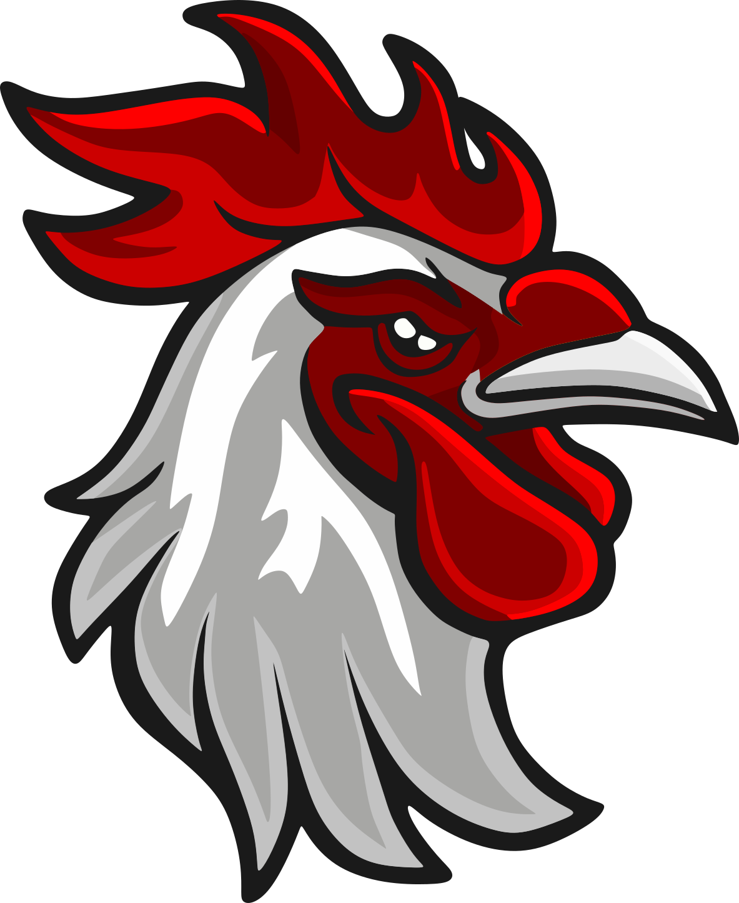
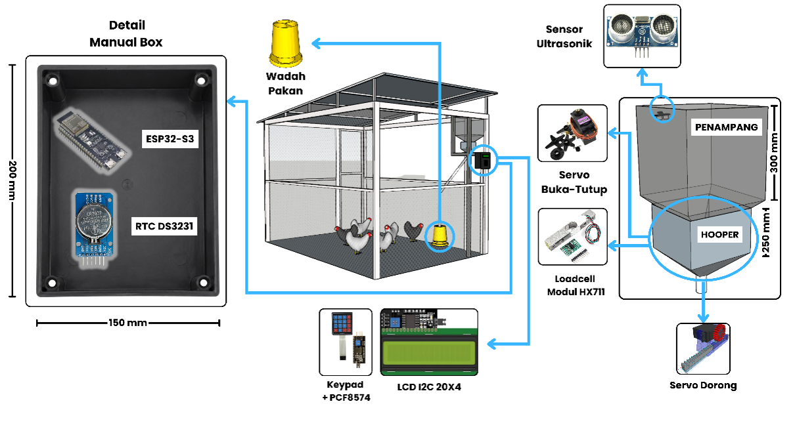
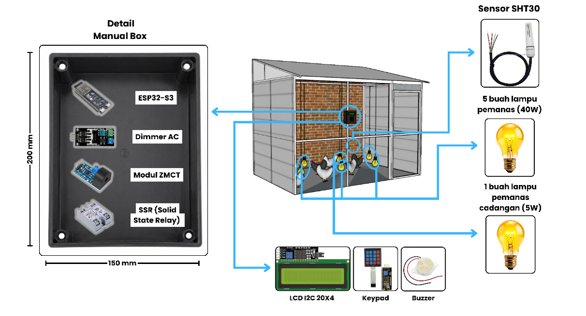
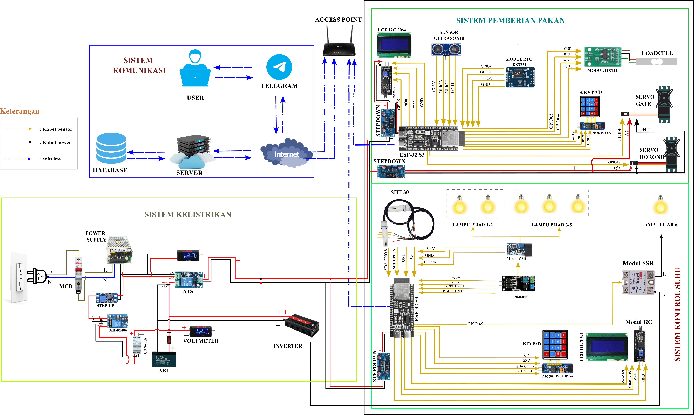

<!-- BADGES - Technology Stack & AI Assistants -->
<p align="center">
  
  
  
  
  
  
  
  
  
  
  
  
  <br/>
  
  
  
</p>

<!-- LOGO & TITLE -->
<p align="center">
  
</p>

<h1 align="center">Goldenchick</h1>
<h3 align="center">IoT-Based Coop Temperature Monitoring & Scheduled Chicken Feeding System</h3>

<p align="center">
  <a href="#license"></a>
</p>

---

## 📖 Table of Contents
- [Overview](#overview)
- [System Architecture](#system-architecture)
- [Key Features](#key-features)
- [Technology Stack](#technology-stack)
- [Multi-User & Multi-Device Scheme](#multi-user--multi-device-scheme)
- [Prerequisites & Installation](#prerequisites--installation)
- [Usage Guide](#usage-guide)
- [Device Layouts](#device-layouts)
- [Limitations & Future Development](#limitations--future-development)
- [License](#license)
- [Contact](#contact)

---

## Overview

**Goldenchick** is an integrated monitoring and control system for chicken coops that allows farmers to **monitor temperature in real-time with a PID mechanism** and **schedule automatic feeding**. The system is designed with a *multi-layered microservices* architecture for high scalability, supporting multi-tenant (multiple farms) and multi-device (multiple microcontrollers per farm) capabilities.

Each farmer gets exclusive access to a personal dashboard after validation, ensuring the security and privacy of each farm's data.

---

## System Architecture

Goldenchick is built using a **Multi-Layering System** approach with Docker & Nginx as the infrastructure foundation.

<p align="center">
  
</p>

| Layer | Technology / Implementation | Description |
|---|---|---|
| **Infrastructure** | Docker Compose, Nginx | Containerization & reverse proxy for all microservices. |
| **Application** | HTML, CSS, JS, Tailwind, Telegram Bot | Responsive web interface and real-time notifications via bot. |
| **Presentation** | JSON | Standard data exchange format between services. |
| **Integration** | API Gateway (Node.js & FastAPI) | Single entry point for all client requests. |
| **Business Logic** | Node.js, Python | Business rules processing, PID logic, feed scheduling, and authentication. |
| **Data Access** | Node.js, SQLAlchemy | Object-Relational Mapping and query builder. |
| **Data Storage** | PostgreSQL | Main relational database for user, farm, token, and sensor log data. |
| **Messaging** | Mosquitto MQTT Broker | Lightweight protocol for real-time communication between server and ESP32. |
| **Connectivity** | WiFi (ESP32-S3) | Connects hardware devices to the internet. |
| **Perception** | ESP32-S3 (C/Arduino) | Microcontroller with sensors, actuators, and WiFi Provisioning feature. |


🍽️ Feeder Layout
<p align="center">  </p>
🌡️ Temperature Controller Layout
<p align="center">  </p>
🔌 System Wiring Diagram
<p align="center">  </p>

---

## Key Features

### 🌡️ Coop Temperature Controller (PID Controller)
- **PID Control:** Temperature sensor (trigger) and dimmer (actuator) work in a PID loop to maintain temperature at the *setpoint* (midpoint of high & low limits).
- **Dynamic Setpoint:** Manually adjustable from the device keypad or *in real-time* from the website.
- **Heater Failover:** A current sensor detects the electrical flow to the main heater. If it fails, a relay automatically switches to a battery-based backup heater.

### ⏰ Scheduled Feeding
- **Two-Stage Precision:**
  1.  **Hopper (Reservoir):** Feed is stored in a fixed-size container.
  2.  **Load Cell Tray:** When the schedule arrives or a button is pressed, a gate servo opens the reservoir. Feed falls onto the *load cell* until the target weight is reached, then the gate closes. A push servo then slides the feed into the feeding trough below.

### 🔐 Multi-User & Multi-Device Access
- **Login System:** Every user must log in to access the dashboard.
- **Token-Based Authorization:** A user account must be assigned a farm token by an admin to view real-time data.
- **Team Collaboration:** One farm can be monitored by multiple accounts (owner & employees).
- **Multi-Device:** One farm can have many devices (temperature/feeder) connected under a single token.

### 📱 WiFi Provisioning
- Easily change the device's WiFi connection by pressing a button and using the official *ESP SoftAP Provisioning* app by Espressif.

---

## Technology Stack

### Software & Backend
- **Container:** Docker, Docker Compose
- **Web Server:** Nginx
- **API & Logic:** Node.js, Python (FastAPI)
- **Database:** PostgreSQL, SQLAlchemy
- **Message Broker:** Eclipse Mosquitto (MQTT)
- **Frontend:** Vanilla HTML/CSS/JS, Tailwind CSS
- **Notification:** Telegram Bot API

### Hardware
- **Microcontroller:** Espressif ESP32-S3
- **Firmware:** Arduino Framework (C/C++)
- **Sensors & Actuators:** SHT-30, AC Dimmer Robodyn, Heater, Relay fotek, ZMCT10c, Servo MG996R, Load Cell, Keypad 3x4, LCD 20x4 I2C, HC-SR04.

### AI Development Assistants
This project was developed with the assistance of:
- **Anthropic (Claude)**
- **OpenAI (ChatGPT)**
- **DeepSeek**

---

## Multi-User & Multi-Device Scheme

Goldenchick's authorization and multi-tenancy flow:

1.  **General Registration:** Anyone can register, but can only see the guide dashboard.
2.  **Farmer Onboarding:** A farmer (e.g., Mr. Ren) contacts the admin to install devices and activate their account.
3.  **Token Assignment:** The admin links Mr. Ren account to a unique token for his farm (e.g., `nova-jaya-farm`). Mr. Ren can now see *real-time* data and control his devices.
4.  **Multi-User:** Employees registered by Mr. Ren can ask the admin to link their accounts to the same token. Now 3 people can monitor `nova-jaya-farm`.
5.  **Multi-Device:** Mr. Budi from `barakah-farm` orders 2 temperature controllers and 3 scheduled feeders. All five devices send data using one single token. The server handles multiple *incoming data* streams from various devices within one farm.

---

## Limitations & Future Development
While the system is already functional, several areas are planned for future improvement:

- End-device security: ESP32 communication still uses a non-encrypted port.
- WiFi provisioning: The open Access Point mode during provisioning is vulnerable to attacks.
- Server rate limiting: No rate limiting is implemented yet, making the system susceptible to DDoS/DoS attacks.
- Feed sensor: The ultrasonic sensor in the reservoir is inaccurate and prone to damage; it is planned to be replaced with a full load cell system.
- Mobile experience: The web interface is still browser-based and not yet wrapped in a WebView for a better Android experience.
- Frontend framework: The project still uses vanilla HTML/CSS/JS, with a migration plan to React/Vue.
- Token security: Token validation is still handled directly in the business logic layer and should be isolated in a gateway or dedicated service.
- Session management: A cookie issue sometimes forces users to re-login; this needs to be fixed in the persistent login mechanism.

---

## License
This project is licensed under the MIT License. See the LICENSE file for full details.

---

## Contact
For more information about device installation or farm token activation, please contact us at:

📧 goldenchickapp@yahoo.com

<p align="center">Made with ❤️ by the Goldenchick Team</p> ```

---

## Prerequisites & Installation
1.  **Clone Repository**
    ```bash
    git clone https://github.com/Abong-123/goldenchick.git
    cd goldenchick
